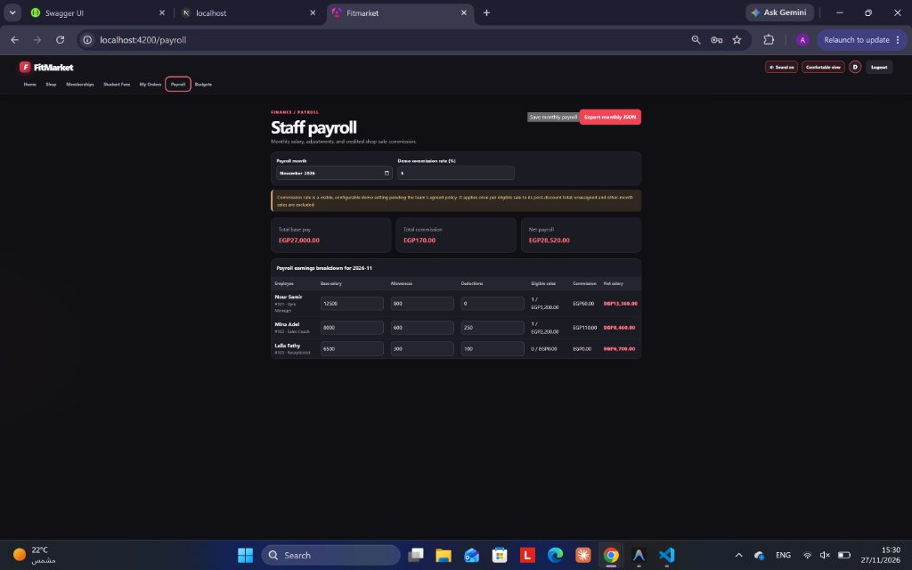
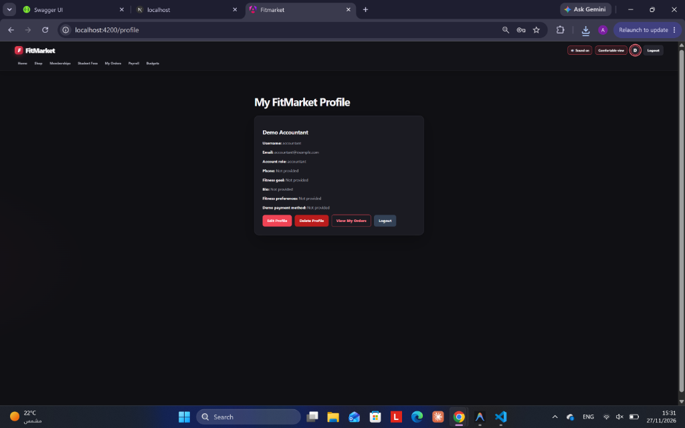
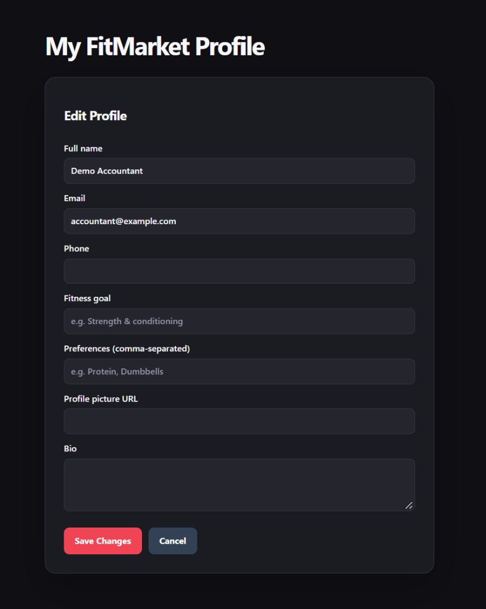
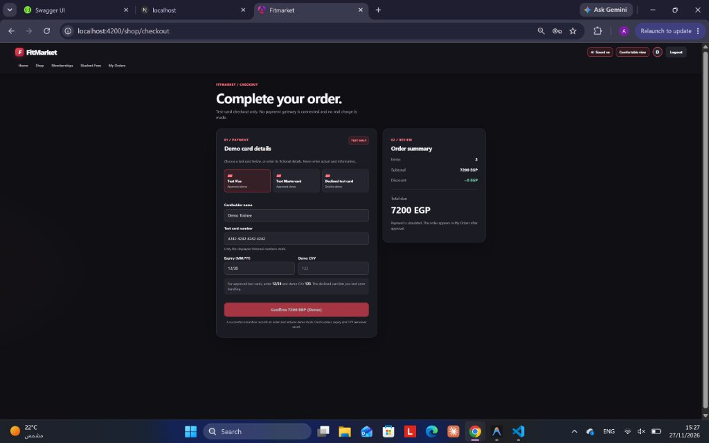
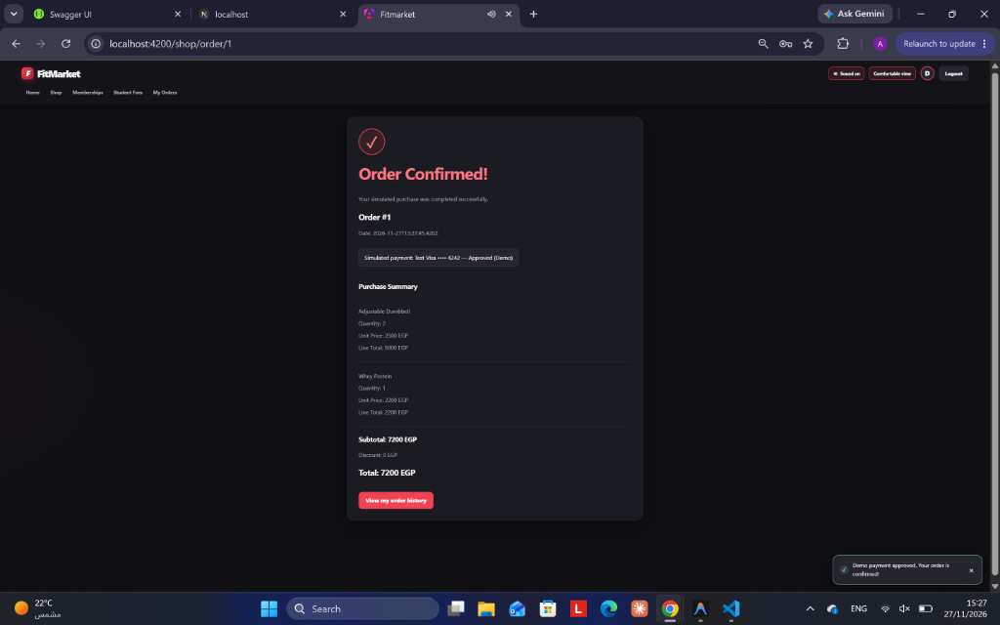

# FitMarket — ICS 511 Milestone 2 Report

**Course:** ICS 511 — Web Programming | **Project:** FitMarket (Gym Management & Fitness E-Commerce) | **Submission Date:** 12 December 2026

---

## Page 1 — Team Overview, Architecture & Storage / Security

### 1. Team Members & Workstream Ownership
| Member | GIU ID | GIU Email | Milestone 2 Ownership |
| --- | --- | --- | --- |
| **Abdelrahman Mohamed** | `<16001205>` | `<abdelrahman@student.giu-uni.de>` | Database-backed Payroll + JSON export, User Profile CRUD + Angular integration, Standardized HTTP feedback, QA & Deliverables Coordination |
| **Abdullah Hassib** | `<HASSIB_ID>` | `<hassib@student.giu-uni.de>` | Authentication, Sanctum/Role Authorization Contract & User Management |
| **Mohamed** | `<MOHAMED_ID>` | `<mohamed@student.giu-uni.de>` | Shop Catalog, Cart, Checkout & Confirmed Sales / Commission Source |
| **Omar** | `<OMAR_ID>` | `<omar@student.giu-uni.de>` | Budgets Module, Charting, LogRocket & Performance Case Study |

### 2. Full-Stack Architecture & Database Design
FitMarket pairs the **Angular 22** standalone-component frontend with a **Laravel** REST API backed by **MySQL** migrations:
- **User Profiles (`user_profiles`):** 1-to-1 foreign-key relationship with `users.id` (`cascadeOnDelete`), storing `name`, `email`, `phone`, `bio`, `fitness_goal`, `profile_picture`, and JSON `preferences`.
- **Payroll Schema (`staff_payroll_profiles`, `monthly_payroll_adjustments`, `payroll_runs`, `payroll_records`):**
  - Enforces a unique constraint on `(staff_id, month)` for monthly allowances/deductions and `(payroll_run_id, staff_id)` for persisted monthly payroll runs.
  - **Reproducible Net-Salary Formula:**
    $$\text{Commission} = \text{round}(\text{EligibleSalesTotal} \times \text{CommissionRate},\ 2)$$
    $$\text{NetSalary} = \text{round}(\text{BaseSalary} + \text{Allowances} + \text{Commission} - \text{Deductions},\ 2)$$
  - Eligible sales are filtered by matching `staff_id` and `YYYY-MM` date prefix on post-discount sale totals; unassigned or out-of-month sales are excluded.

### 3. Security, Authorization & Browser Storage Rationale
- **Role-Based Access Control (RBAC):**
  - Payroll endpoints (`/api/payroll*`) and the Angular `/payroll` route strictly require `admin` or `accountant` roles. Unauthenticated requests return `401`; non-accountant (`trainee`) requests return `403`.
  - Profile endpoints (`/api/profiles/{userId}`) enforce ownership: authenticated users can only create, read, update, or delete their own profile unless an `admin` overrides.
- **Browser Storage Hygiene:**
  - Confidential payroll records, salaries, and payment card secrets (CVV/expiry/card numbers) are **never** stored in `localStorage` or `sessionStorage`.
  - Session identity uses tab-scoped `sessionStorage`, and demo-mode profile preferences store only non-sensitive display fields.
- **Standardized Error & Success Feedback:**
  - Angular `normalizeHttpError()` and `apiFeedbackInterceptor` map `400/422` (validation field bags), `401` (unauthorized), `403` (forbidden), `404` (not found), `500+` (server error, hiding SQL/stack internals), and `0` (network failure) to consistent UI alert banners and `Feedback` toasts.

---

## Page 2 — Implemented Features & Visual Evidence

### 4. Payroll & Monthly JSON Export (Abdelrahman)
Accountants and admins can adjust base salaries, monthly allowances/deductions, and commission rates, persist monthly payroll runs to MySQL, and export a monthly JSON report whose employee rows and totals match the displayed table (`27,000.00` EGP base pay, `170.00` EGP commission, `28,520.00` EGP net payroll).

### 5. User Profile CRUD & Persistence (Abdelrahman)
Authenticated users can view, create, edit, and delete their profile with client + server validation (`422`), persistence across refresh/re-login, and clear feedback banners.

| Profile View & Actions | Edit Profile Form |
| :---: | :---: |
|  |  |

### 6. Shop Checkout & Order Confirmation (Mohamed)
Simulated test-card checkout validates inputs, keeps payment secrets out of storage, and surfaces standardized success toast feedback upon confirmation.

| Demo Checkout | Order Confirmed + Success Toast |
| :---: | :---: |
|  |  |

---

## Page 3 — Testing Evidence, Fixes & Team Deliverables

### 7. Automated Test Coverage
- **Angular Unit & Integration Suite (`npm run test:vitest`):** **36 test files / 118 tests passed** (`ng build` also succeeded with zero errors).
  - **Profile CRUD (`profile.service.spec.ts`, `profile.spec.ts`):** Verifies `GET`/`POST`/`PUT`/`DELETE`, persistence across logout/re-login and component reload, `422` validation rejection, and `403` cross-user edit protection.
  - **Payroll (`payroll-calculation.service.spec.ts`, `payroll-api.service.spec.ts`, `payroll-page.spec.ts`):** Verifies net-salary math, JSON export parity with displayed rows/totals, and `403` blocking for non-accountants.
  - **HTTP Feedback (`api-error.spec.ts`, `feedback.spec.ts`):** Verifies `401`, `403`, `404`, `422`, `500`, and `0` normalization plus global interceptor toast behavior.
- **Laravel PHPUnit Feature Tests (`backend/tests/Feature/`):**
  - `ProfileApiTest`: Tests `401` unauthenticated, full CRUD lifecycle + `404` after delete, `422` validation errors, and `403` non-admin vs. `200` admin override.
  - `PayrollApiTest`: Tests `401`/`403` role enforcement, salary/adjustment updates, persisted `payroll_runs`, JSON report parity, and `404`/`422` negative cases.
  - *(Note: Run `composer install && php artisan migrate --seed && php artisan test` in a PHP 8.2+ / MySQL environment to execute backend tests live.)*

### 8. Key Issues Found & Fixes Applied
1. **Test Runner Compatibility:** Replaced Vitest-only `.rejects.toMatchObject` assertions with `try/catch` status checks so all Angular specs run cleanly under both Karma/Jasmine and Vitest.
2. **Error Surface Consistency:** Added `apiFeedbackInterceptor` and inline `role="alert"` banners on Profile and Payroll pages so `401`/`403`/`404`/`422`/`500` responses always display actionable feedback without leaking stack traces.
3. **Storage Safety:** Kept confidential payroll data in memory/API-only (`PayrollApiService`) rather than `localStorage`, ensuring sensitive finance figures stay out of browser storage.

### 9. Remaining Team Placeholders (Insert Before Final PDF Export)
- `[Insert Auth / Admin User Management Screenshot — Abdullah Hassib]`
- `[Insert Budgets Chart & LogRocket Performance Case Study Screenshots — Omar]`
- `[Insert Laravel php artisan test Terminal Screenshot once MySQL/PHP environment is connected]`
